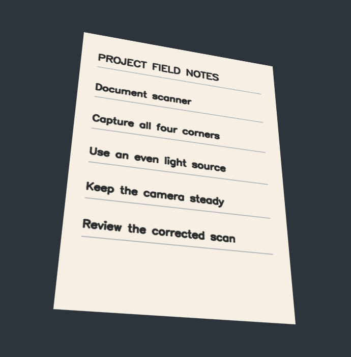
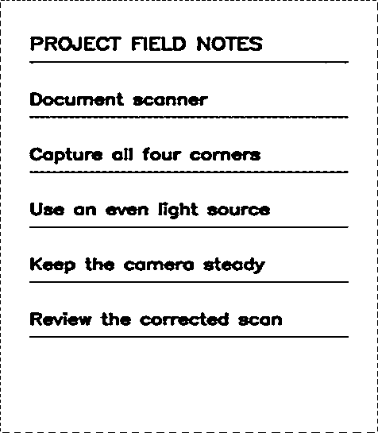

# Smart Document Scanner

A local Streamlit app that turns a photo of a flat document into a perspective-corrected PNG. It uses classical computer vision and runs on a CPU. Start with automatic detection, then adjust the corners and orientation if the page needs a correction.

## Before and after

The left image is a synthetic document generated with OpenCV. The right image is the actual black-and-white PNG produced by the scanner from that input.

| Synthetic input | Scanner output |
| --- | --- |
|  |  |

## Features

- Upload JPEG, PNG, and WebP photos up to 20 MB and 32 megapixels.
- Detect the boundary of a single portrait or landscape document.
- Adjust all four corners manually using a numbered preview and source-pixel coordinates.
- Choose perspective-corrected color, enhanced grayscale, or black and white.
- Rotate the output 0°, 90° clockwise, 180°, or 270° clockwise.
- Compare the source and result side by side and download a lossless PNG.
- Get a clear message when an upload cannot be read or the document boundary cannot be detected.

## Computer vision pipeline

1. **Decode and orient.** Pillow validates the file format, applies the EXIF orientation, and converts the image to OpenCV's BGR layout.
2. **Extract edges.** OpenCV caps the detection image's longer side at 1,200 pixels, converts it to grayscale, applies a Gaussian blur, and runs Canny edge detection. Morphological closing bridges small gaps in the edge map.
3. **Find the boundary.** The scanner sorts contours by area and uses Douglas–Peucker polygon approximation to find a sufficiently large, convex quadrilateral. It rejects candidates that closely match the full image frame. If no candidate passes, the app reports detection failure.
4. **Correct perspective.** A convex hull establishes a consistent winding for the four corners. The scanner maps them to the full-resolution source and computes a homography to a rectangle. Opposing edge lengths determine the rectangle's dimensions, so there is no forced paper size or fixed output resolution.
5. **Render the scan.** Color retains the warped source colors. Enhanced grayscale applies contrast-limited adaptive histogram equalization (CLAHE). Black and white uses adaptive Gaussian thresholding with a resolution-dependent window to account for local changes in brightness.
6. **Orient and export.** Apply the chosen quarter-turn to the rendered scan before showing the preview and encoding the PNG. Quarter-turns preserve pixel values.

## Technologies

- **OpenCV and NumPy** for contour detection, perspective correction, and scan rendering.
- **Pillow** for decoding uploads and applying EXIF orientation.
- **Streamlit** for the browser interface, preview, and download.
- **pytest** for automated tests.

## Install and run on Windows

Install 64-bit Python 3.11 or newer, with Python 3.13 recommended. Open PowerShell in the extracted or cloned project directory, where `app.py` and `requirements.txt` are located.

```powershell
python -m venv .venv
.\.venv\Scripts\python.exe -m pip install -r requirements.txt
.\.venv\Scripts\python.exe -m streamlit run app.py --server.address 127.0.0.1 --server.maxUploadSize 20
```

If Windows resolves `python` to the Microsoft Store alias, use `py -3 -m venv .venv` when the Python Launcher is available, or invoke an installed interpreter by its full path. The commands use the virtual environment directly and work without activation.

## Usage

1. Open [the local app](http://127.0.0.1:8501) or use the address printed by Streamlit.
2. Upload a photo with all four document corners visible. For a quick trial, use `examples/synthetic-photo.png`.
3. Keep **Document boundary** set to **Automatic** for detection or choose **Manual corners** to edit the boundary.
4. Select a scan style. If text appears sideways or upside down, use **Output rotation** to make it upright.
5. Inspect the scan and click **Download PNG**. The file uses the boundary, style, and rotation shown in the scan preview.

### Adjust the document corners

1. Choose **Manual corners**. The editor starts with the detected corners when available and shows an inset rectangle when detection fails.
2. Set the **X** and **Y** fields for each numbered marker. X increases to the right and Y increases down from the upper-left pixel at (0, 0). Press Enter or leave a field to apply its value. The values refer to the full-size photo after EXIF orientation, even when the preview is scaled to fit the browser.
3. Place one marker on each page corner. The scanner orders the points automatically. Four distinct corners must form a sufficiently large convex quadrilateral before the scan can be downloaded.

To try the editor, upload `examples/synthetic-photo.png`, select **Manual corners**, and enter (165, 63), (535, 130), (580, 635), and (105, 605). Check that the outline follows the page. Choose **90° clockwise** and confirm that the preview and downloaded PNG both rotate and swap width and height. To exercise manual recovery on a real photo, use one where automatic detection reports no boundary and place the four markers on the page yourself.

## Automated testing

From the project directory:

```powershell
.\.venv\Scripts\python.exe -m pytest -q
```

The tests cover corner ordering and homography mapping, manual corner validation, portrait and landscape inputs at multiple resolutions, detection failure, invalid uploads and image arrays, output dimensions, scan modes, EXIF rotation, all four output rotations, and lossless PNG export after manual correction. They use synthetic fixtures.

## Real-world limitations

- The detector assumes a single flat, approximately rectangular page with all four corners visible. Cropped edges, curled pages, glare, and low contrast can prevent detection.
- Other prominent rectangles can be mistaken for the page. A candidate must cover at least 10% of the detection image, so distant pages may be missed.
- EXIF orientation is honored. Use the output rotation control to orient document text.
- The manual editor uses numeric inputs. Precise placement on high-resolution images may take a few adjustments.
- Output dimensions are estimated from the image geometry. Physical paper size and DPI are unavailable, and thresholding can produce artifacts along edges or in textured regions.
- The included example and tests use synthetic images. Real-world detection accuracy has not been measured.

## Future improvements

- Add zoom and draggable corner markers for faster manual placement.
- Evaluate on a labeled set of real photos with varied lighting, backgrounds, and camera angles.
- Add illumination normalization for strong shadows and an optional PDF export.
